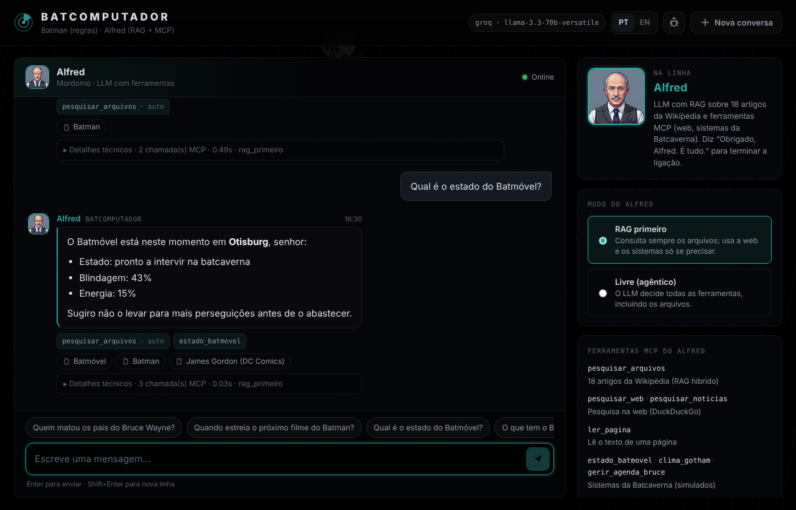
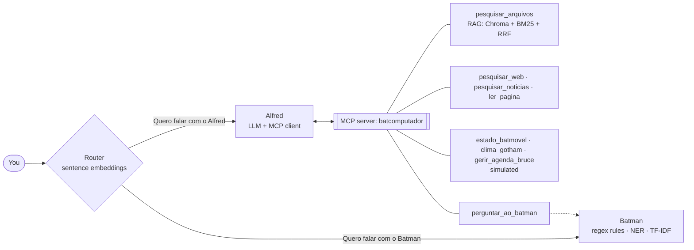

# Batcomputer: talk to Batman and Alfred

A hybrid conversational agent in **European Portuguese and English**, built for the Natural Language Interaction course of the MSc in Artificial Intelligence at the University of Coimbra.

You talk to **Batman**, a classic rule-based agent (ELIZA-style regex rules, spaCy NER, edit-distance correction and TF-IDF intent matching). Ask for **Alfred** and an embedding router hands the conversation over to an **LLM agent** that answers with **RAG** over 18 Wikipedia articles (Portuguese or English, following the chat language) and **MCP tools**: web and news search, page reading, simulated Batcave systems, and a tool to consult Batman himself.



> 🇵🇹 **Resumo:** chatbot híbrido (Batman de regras + Alfred com LLM, RAG e ferramentas MCP), em português ou inglês. Instala as dependências, escolhe o LLM no `.env` (Ollama local ou Groq/OpenRouter/Hugging Face) e corre `python webapp/server.py`.

## How it works



Alfred has two modes, switchable in the web app:

| Mode | Behaviour |
|---|---|
| `rag_primeiro` (default) | The RAG always runs first and its excerpts go into the prompt; the LLM calls other tools only if it needs to. |
| `livre` | Agentic RAG: the LLM decides every tool call, archives included. |

The web app shows, for every Alfred answer, which tools were called, the sources it used (archive articles and web links) and a collapsible trace. **Debug mode** (bug icon) also shows the router similarities, NER, POS tags and TF-IDF matches.

More detail: [`docs/rag_agent_flowchart.png`](docs/rag_agent_flowchart.png) (D2) and [`docs/diagrama_d3_mcp.png`](docs/diagrama_d3_mcp.png) (D3).

## Quick start

Requires **Python 3.10+**.

```bash
git clone <this-repo-url> batcomputer && cd batcomputer
python -m venv .venv
source .venv/bin/activate                 # Windows: .venv\Scripts\Activate.ps1
pip install -r requirements.txt
python -m spacy download pt_core_news_sm
python -m spacy download en_core_web_sm   # English mode
cp .env.example .env                      # then choose your LLM (next section)
python scripts/preparar.py                # one-off: downloads the models and builds the vector DB
python webapp/server.py                   # → http://localhost:8001
```

`scripts/preparar.py` is optional (the same happens on the first run), but it makes the first start faster and tells you early if something is missing.

### Choose an LLM

Alfred needs a chat model **with tool calling**. Set it in `.env`:

| Provider | `.env` | Notes |
|---|---|---|
| [Ollama](https://ollama.com) (local, free) | `LLM_PROVIDER=ollama` | `ollama pull qwen2.5:7b` and keep Ollama running. |
| [Groq](https://console.groq.com) (free tier) | `LLM_PROVIDER=groq`<br>`GROQ_API_KEY=...` | Fast; default model `llama-3.3-70b-versatile`. |
| [OpenRouter](https://openrouter.ai) | `LLM_PROVIDER=openrouter`<br>`OPENROUTER_API_KEY=...` | Any model with tool support, e.g. `LLM_MODEL=openai/gpt-4o-mini`. |
| [Hugging Face](https://huggingface.co/inference-providers) | `LLM_PROVIDER=huggingface`<br>`HUGGINGFACEHUB_API_TOKEN=...` | Default `meta-llama/Llama-3.3-70B-Instruct`. |

Override the model with `LLM_MODEL=...`. Batman (rules) works without any LLM; only Alfred needs one.

### Docker

```bash
docker build -t batcomputer .
docker run -p 7860:7860 -e LLM_PROVIDER=groq -e GROQ_API_KEY=your_key batcomputer
# → http://localhost:7860
```

With Ollama on the host: `-e LLM_PROVIDER=ollama -e OLLAMA_BASE_URL=http://host.docker.internal:11434`.

To publish a free public demo on **Hugging Face Spaces**, see [`docs/DEPLOY.md`](docs/DEPLOY.md).

## Things to try

The **PT/EN** switch changes the whole conversation, not just the interface: in English, Batman uses English rules, Alfred answers in English and searches the English Wikipedia articles. Switching language starts a new chat.

| | Português | English |
|---|---|---|
| Batman (rules) | `O que sabes sobre o Joker?` · `Onde está o Batmóvel?` | `What do you know about the Joker?` · `Where is the Batmobile?` |
| Call Alfred | `Quero falar com o Alfred` | `I want to talk to Alfred` |
| Archives (RAG) | `Quem matou os pais do Bruce Wayne?` | `Who killed Bruce Wayne's parents?` |
| Web search | `Quando estreia o próximo filme do Batman?` | `When does the next Batman movie come out?` |
| Batcave systems | `Qual é o estado do Batmóvel?` | `What's the status of the Batmobile?` |
| **End the call with Alfred** | `Obrigado, Alfred. É tudo.` | `Thanks, Alfred. That's all.` |

Other phrases that end the call: `Adeus Alfred`, `Termina a ligação` / `Bye Alfred`, `End call`, `Hang up`. Alfred says goodbye and the line goes back to Batman. `Quero falar com o Batman` / `I want to talk to Batman` also works (through the router).

## Other ways to run it

```bash
python agente_hibrido.py                        # terminal chat (type "debug", "modo", "quit")
USAR_MCP=0 python agente_hibrido.py             # D2 behaviour: fixed RAG, no MCP tools
MODO_AGENTE=livre python agente_hibrido.py      # start Alfred in "livre" mode
python rule_based.py                            # Batman only (D1)
python rule_based_en.py                         # Batman only, in English
IDIOMA=en python agente_hibrido.py              # terminal chat in English
python rule_based.py vs 5                       # Batman vs ELIZA, 5 turns
python mcp/cliente/agente_mcp.py "Quem é o Ra's al Ghul?"   # MCP agent alone, one question
python mcp/servidor/mcp_servidor.py --http   # MCP server over HTTP on :8002 (for MCP Inspector etc.)
```

## Configuration

All settings are environment variables (or `.env`); see [`.env.example`](.env.example). The most useful:

| Variable | Default | |
|---|---|---|
| `LLM_PROVIDER`, `LLM_MODEL` | `ollama`, per provider | LLM used by Alfred |
| `MODO_AGENTE` | `rag_primeiro` | Alfred's default mode |
| `USAR_MCP` | `1` | `0` = D2 mode (RAG without MCP) |
| `HOST`, `PORT` | `127.0.0.1`, `8001` | Web server |
| `RATE_LIMIT_PER_MIN` | `20` | Messages per minute per IP (`0` = off) |
| `AGENTE_TIMEOUT` | `180` | Max seconds per Alfred answer |
| `MCP_LOG_FILE` | (off) | Full log of every MCP call, e.g. `logs/mcp_tools.log` |

## Project layout

```
├── agente_hibrido.py        router + Batman/Alfred turn logic (terminal entry point)
├── rule_based.py            D1: rule-based Batman (and ELIZA), Portuguese
├── rule_based_en.py         the same Batman in English
├── idiomas.py               router phrases, "end the call" phrases and fixed lines per language
├── modelos_llm.py           LLM provider selection (Ollama / Groq / OpenRouter / HF)
├── rag/
│   ├── rag_system.py        D2: PDFs, Chroma vector DB, BM25 + dense + RRF retriever
│   ├── pdffiles/            the 18 Portuguese Wikipedia articles (CC BY-SA)
│   ├── pdffiles_en/         the English ones (downloaded by scripts/preparar.py)
│   └── evaluation/          RAG evaluation notebook, metrics and results
├── mcp/
│   ├── servidor/            MCP server (FastMCP) and its tools
│   ├── cliente/agente_mcp.py  Alfred: LLM + MCP client loop
│   └── avaliacao/           D3 evaluation notebook, metrics and results
├── webapp/
│   ├── server.py            HTTP server + JSON API (standard library only)
│   └── static/              web UI (HTML/CSS/JS, no build step)
├── scripts/preparar.py      one-off model download + vector DB build
├── tests/                   offline tests (no models, network or LLM needed)
└── Dockerfile               Docker / Hugging Face Spaces image
```

### Web API

| Route | |
|---|---|
| `GET /api/health` | liveness |
| `GET /api/status` | LLM provider/model, MCP on/off, Alfred's default mode |
| `POST /api/start` | new conversation → `{sessao_id, saudacao, modo_agente}` |
| `POST /api/say` | `{sessao_id, texto, modo_agente?}` → answer, agent, tool calls, sources, debug data |

## Tests

```bash
python -m pytest -q tests
```

They run in about two seconds with fakes for the LLM and the MCP client: LLM configuration, RRF fusion, the agent's tool loop (modes, call limit, sources), the SSRF guard of `ler_pagina`, the agenda limits, and the PT/EN configuration and "end the call" phrases.

## Evaluation

The evaluation notebooks from the course deliverables are included with their results:

- **RAG (D2)** – `rag/evaluation/evaluate_rag.ipynb`: retrieval (P@k, R@k, Hit Rate, MRR), LLM-as-judge, Ragas (faithfulness, answer relevancy, context precision/recall, correctness), BLEU, ROUGE-L, token F1, with vs. without RAG.
- **MCP agent (D3)** – `mcp/avaliacao/avaliar_d3.ipynb`: each tool on its own, tool selection precision/recall, argument validity, success rate and latency, answer correctness and faithfulness, in both modes.

They need `pip install -r requirements-eval.txt` and an `OPENROUTER_API_KEY` for the judge model.

## Notes and limitations

- The English mode is a port of the Portuguese system: the evaluation in the course deliverables (D2/D3) was done in Portuguese only. It needs the agent MCP mode (`USAR_MCP=1`).
- Each language runs its own MCP server (its own vector DB), so English adds a second process. `PRELOAD_EN=0` starts it only on the first English question.
- Batcave systems (vehicle status, Gotham weather, Bruce's agenda) are **simulated** for demonstration.
- One question is answered at a time (shared lock), which fits a local LLM; on a public demo, extra users wait in line.
- Small local models sometimes pick the wrong tool; the `rag_primeiro` mode is the most reliable with them.

## Credits and license

Authors: Miguel and Luís (MSc in Artificial Intelligence, University of Coimbra).

Code under the [MIT License](LICENSE). The archive articles in `rag/pdffiles/` and `rag/pdffiles_en/` come from the [Portuguese](https://pt.wikipedia.org) and [English](https://en.wikipedia.org) Wikipedia and are licensed under [CC BY-SA 4.0](https://creativecommons.org/licenses/by-sa/4.0/).

This is a non-commercial fan and academic project. Batman, Alfred, Gotham City and related characters are trademarks of DC Comics; this project is not affiliated with or endorsed by DC Comics or Warner Bros.
# BatLore
